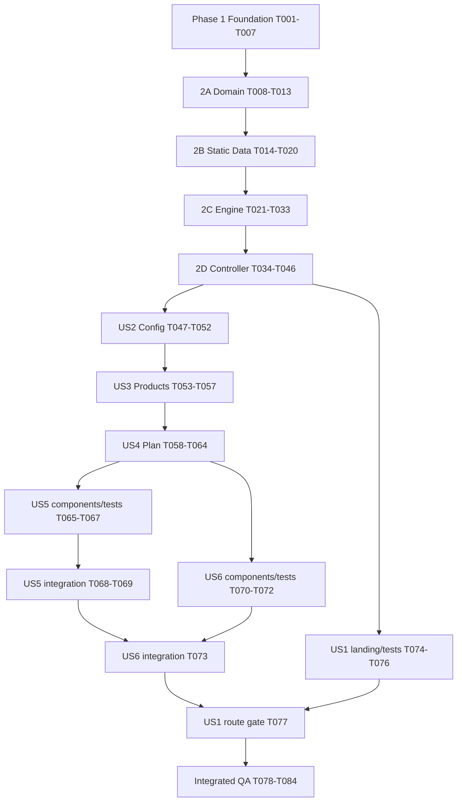

# Tasks: RAIZORA MVP — planejamento nutricional público

**Feature**: `001-raizora-mvp` | **Data**: 2026-10-04 | **Status**: MVP COMPLETE — 84/84 tarefas concluídas; zero abertas.

**Input**: [spec](spec.md), [plan](plan.md), [research](research.md), [data-model](data-model.md), [contrato de cálculo](contracts/calculation.md), [contrato do wizard](contracts/wizard.md), [quickstart](quickstart.md), [planning-review](planning-review.md), [constitution 1.0.1](../../.specify/memory/constitution.md) e [decisões/OQs](open-questions.md).

**Prerequisites**: planning-review PASS/READY FOR TASKS; OQ-001–OQ-012 resolvidas; OQ-013 OPTIONAL/DEFERRED. Esta rodada gera documentação, sem scaffolding, instalação, código ou execução das tarefas abaixo. TASKS READY descreve a preparação deste plano; executar `$speckit-implement` exige uma rodada autorizada própria.

**Tests**: unitários matemáticos e integração/UI solicitados são obrigatórios. Não usar snapshots como estratégia principal, percentual arbitrário de coverage, Playwright ou dependências fora do plan. Os gates são casos e ramos especificados, além de browser real.

**Organization**: Phase 1 é setup; Phase 2 reúne fundamentos compartilhados em quatro subfases técnicas. As fases seguintes correspondem às histórias originais da spec em prioridade P1 (US2–US6), depois P2 (US1). A prioridade de apresentação não impõe dependência: landing e componentes independentes podem avançar nas ondas explicitadas ao final. Todas as seis telas integram o MVP.

## Execução autorizada — 2026-10-07

Primeiro bloco concluído: Foundation, Domain, Static Data, Calculation Engine e
unit tests do engine (T001–T033). Evidências em [implementation-review](implementation-review.md).
Orchestrator como executor principal, um worker para foundation/auditoria de dados;
sem revisão multi-agent completa. T034–T084 aguardam nova rodada autorizada.
Os parágrafos documentais acima e o registro de geração ao final são históricos.

Segundo bloco concluído nesta rodada: Calculator Core/State/Validation/Presentation,
Landing, Configuração e Produtos (T034–T057 e T074–T076, 27 tarefas).
Executado somente pelo orchestrator, sem delegação ou revisão multi-agent completa.
267 testes GREEN; lint/typecheck/tests/build PASS; smoke local das três telas em
360/768/1280 px. Bloco 1 preservado sem alterações no domínio/dados/testes matemáticos.
Plano usa somente placeholder estrutural, sem conteúdo de resultado. T058–T073 e
T077–T084 continuam abertas; T077 depende de Receita/Resumo e não foi antecipada.
Não iniciar o bloco seguinte automaticamente.

Terceiro bloco autorizado e concluído: T058–T073 e T077–T084 (24 tarefas).
Plano, Receita, Resumo, integração, QA/browser, produção e documentação final.
**MVP COMPLETE: 84/84 concluídas, zero abertas; 294 testes GREEN.**
Lint/typecheck/unit/ui/build/browser smoke PASS. Orchestrator executou e revisou
sem multi-agent, conforme instrução explícita desta rodada, que substitui o trecho
advisory de architect no aceite original de T083. Evidências e limites em
[implementation-review](implementation-review.md). Não iniciar V2/deploy automaticamente.

## Convenções e limites de execução

- Formato: `- [X] Tnnn [P?] [USn?] descrição com caminho`. `Dep.` lista pré-requisitos obrigatórios; `Aceite` define conclusão verificável. IDs em ordem topológica; uma dependência nunca é autorização para expandir escopo.
- `[P]` significa elegível para uma onda paralela **depois** de todas as dependências concluídas e sem outro agente escrevendo os mesmos arquivos. Não significa que todas as tarefas marcadas podem começar juntas. Tarefas sem `[P]` são sequenciais no seu ramo; ramos independentes podem ser coordenados pelo principal.
- Principal integra, valida e modifica arquivos compartilhados. Workers recebem IDs, arquivos exclusivos, dependências, aceite e exclusões. Explorer/researcher/architect são advisory. Architect revisa plano substancial antes de implementação, recorrência de falha e conclusão; respeitar AGENTS.md.
- Tarefas de teste vêm antes da implementação correspondente. Aceite de teste novo pode ser RED esperado e documentado contra comportamento ainda ausente, sem falha de configuração/import não intencional; criar somente o scaffold mínimo necessário na tarefa de teste. Implementações fecham os casos no checkpoint indicado. RED previsto de TDD não é regressão autorizada nem motivo para marcar tarefa de implementação concluída.
- Durante ondas paralelas, checks UI dos checkpoints T052/T057/T064/T069/T073 executam os arquivos de teste do ramo atual e das histórias já concluídas, por filtro de caminhos do Vitest; RED esperado de outro ramo é identificado separadamente e não integra o gate local. Isso permite concluir T069 enquanto T070 aguarda T073, e antecipar landing sem bloquear US2–US6. Regressão em suíte já concluída sempre bloqueia. Nos joins T077/T078 e no gate T081, toda a suíte `npm run test:ui` precisa estar GREEN; nenhum RED é tolerado na entrega.
- Helpers matemáticos ficam coesos em `src/domain/calculation/calculate-plan.ts`, preferencialmente privados; testar pela operação pública, sem exportar internals apenas para testes. As tarefas T024–T032 constroem esse módulo sequencialmente; suíte pública completa fica GREEN em T033. Não alterar o contrato para acomodar um incremento parcial.
- Caminhos abaixo são relativos à raiz. `@/` resolve `src/`. Fronteiras: domain importa só domínio; data importa domínio; features recebe Brand/schedule por props; `src/app/calculadora/page.tsx` compõe o dataset. Nenhum import do parceiro no engine/features.
- Estado somente local/useReducer + props, sem Context/store externo/storage/URL de cultivo. Sem backend, banco, auth, Route Handlers, Server Actions, proxy, chatbot, RAG ou integração de outra marca real. Build Next convencional, fontes locais, sem deploy nesta execução.
- Não reabrir SRC-007; duração vem de StageDefinition, frequência da regra. Não inventar máximos agronômicos, doses, redução orgânica, mistura, ordem de preparo ou pH/EC. Não carregar JPEG/PDF no runtime. Copy/assets podem permanecer provisórios e substituíveis; OQ-013 não é gate matemático.
- spec/OQs/review/checklist e planning-review preservam snapshots anteriores. O item histórico de resultados funcionais ainda não executados não deve ser marcado concluído nesta rodada. No início da futura implementação, avaliar checklists pelo workflow vigente, distinguindo evidência histórica de aceite executável; este documento não dispensa os prechecks de `$speckit-implement`.

## Phase 1 — Project Foundation / Setup

**Objetivo**: preparar somente ferramentas aprovadas e shells mínimos das duas rotas, preservando specs, fontes e infraestrutura SDD.

**Gate da fase**: dev inicia; build, typecheck e lint passam; projetos unit/UI executam testes básicos. Não confundir shell com histórias concluídas.

- [X] T001 Inicializar Next.js 16/React 19 com Node 24.x/npm e estrutura do plan em `package.json`, `package-lock.json`, `.nvmrc`, `src/app/layout.tsx`, `src/app/page.tsx`, `src/app/calculadora/page.tsx`, `src/domain/`, `src/data/brands/plantas-que-curam/`, `src/features/calculator/`, `tests/unit/` e `tests/ui/`. Dep.: nenhuma. Aceite: patches compatíveis fixados no lockfile; apenas dependências de plan/research; scaffolding preserva arquivos existentes; rotas básicas renderizam, sem recurso de backend.
- [X] T002 Configurar TypeScript strict, alias `@/` e scripts aprovados em `tsconfig.json`, `next.config.ts` e `package.json`: dev/build/start, lint, typecheck (`next typegen && tsc --noEmit`), test/test:unit/test:ui/test:watch conforme plan. Dep.: T001. Aceite: alias aponta src; typecheck funciona em checkout limpo, sem dev/build anterior; sem output export ou fonte remota obrigatória.
- [X] T003 [P] Configurar ESLint flat e ignores em `eslint.config.mjs` e `.gitignore`. Dep.: T002. Aceite: ESLint CLI com zero warnings, sem next lint; ignorar node_modules/.next/coverage/logs/env conforme setup real; não adicionar ignores de tecnologias ausentes.
- [X] T004 [P] Configurar Tailwind 4/PostCSS e base visual local em `postcss.config.mjs`, `src/app/globals.css` e `src/app/layout.tsx`. Dep.: T002. Aceite: `@tailwindcss/postcss` e import Tailwind 4; fundo claro/verde, tipografia local, foco visível e contraste-base AA; breakpoints padrão mobile-first; sem UI kit, ícones/fontes externos ou alteração dos alvos 360/768/1280.
- [X] T005 Configurar Vitest 4 projects unit/Node e ui/jsdom em `vitest.config.ts` e `tests/setup/ui.ts`. Dep.: T003, T004. Aceite: includes separados `.test.ts`/`.test.tsx`, alias @/ equivalente ao app, Vite/plugin React no runner, jest-dom e cleanup no setup UI; imports de teste explícitos, sem poluir globals do app; nenhum browser runner adicional.
- [X] T006 Adicionar smoke unit/UI em `tests/unit/foundation.test.ts` e `tests/ui/foundation.test.tsx`. Dep.: T005. Aceite: ambos projetos executam e a UI usa render/query semântica real; comprovar resolução do alias e setup jest-dom; não testar detalhes cosméticos por snapshot.
- [X] T007 Verificar fundação e registrar evidências em `specs/001-raizora-mvp/implementation-review.md`. Dep.: T006. Aceite: npm run dev/lint/typecheck/test:unit/test:ui/build funcionam; scripts/versões efetivas registrados; nenhum arquivo fonte/spec perdido; interromper ramo se gate falhar.

## Phase 2 — Foundational / pré-requisitos compartilhados

### 2A — Domain Model e validação estrutural

**Objetivo**: representar exatamente data-model/contracts, sem nova modelagem nem lógica de fabricante. **Gate**: tipos strict e validação estrutural aprovados, gaps tratados como completude.

- [X] T008 Implementar Brand/IDs readonly em `src/domain/brands/types.ts`. Dep.: T007. Aceite: Brand tem somente id/name; RAIZORA não vira fabricante; identidade não fornece estratégia matemática (data-model Brand; FR-002/017).
- [X] T009 Implementar Product/QuantityUnit/IDs em `src/domain/products/types.ts`. Dep.: T008. Aceite: Product tem brandId/name/quantityUnit/aliases opcionais; sem dose, via, frequência ou duração globais; GRAM e MILLILITER incompatíveis (FR-010/017/018).
- [X] T010 Implementar FeedingSchedule, StageDefinition, Dose, NutrientRule, RuleKey, MissingRuleDiagnostic, fontes/metadata e tipos centrais em `src/domain/nutrition/types.ts`. Dep.: T009. Aceite: StageType/WeekNumber/ApplicationType/FrequencyMode/DosageUnit/RuleStatus conforme data-model; FERTIGATION corresponde à via solo da spec; unions ACTIVE/NOT_APPLICABLE/NO_RULE e Frequency discriminadas, readonly; razões STAGE_NOT_APPLICABLE/WEEK_NOT_USED e MISSING/UNCONFIRMED preservadas; duração no schedule, sem weeks[] redundante.
- [X] T011 [P] Implementar CultivationConfiguration, SelectedProductSet, CalculationResponse/Result, WeekCalculation/RuleCalculation, ProductCycleTotal/StageProductTotal/AmountAggregate e issues em `src/domain/calculation/types.ts`. Dep.: T010. Aceite: seleção separada da configuração; SUCCESS/INVALID_INPUT/INVALID_SCHEDULE/NUMERIC_ERROR discriminados; COMPLETE tem Quantity, N/A não tem número, INCOMPLETE não tem total definitivo; codes/path/contexto exatamente do modelo, sem texto UI nem timestamp.
- [X] T012 [P] Escrever testes table-driven estruturais em `tests/unit/validate-schedule.test.ts` com fixtures locais. Dep.: T010. Aceite: U-12/U-14 cobrem IDs/referências/duplicatas/weekCount/weekNumber/dose/unidade/provenance/frequência, EVERY em FOLIAR inválido e inconsistência N/A de estágio; gap e NO_RULE distinguem-se de dado malformado; validar também regra de produto desmarcado; RED esperado antes de T013.
- [X] T013 Implementar validateSchedule em `src/domain/nutrition/validate-schedule.ts`. Dep.: T011, T012. Aceite: testes T012 GREEN; valida objeto inteiro e resolve fontes; ausência esperada gera diagnóstico MISSING, explícito NO_RULE mantém UNCONFIRMED; lacuna não produz INVALID_SCHEDULE nem N/A inventado; nenhuma dependência de React/Next/dataset.

### 2B — Static Feeding Data / Plantas que Curam

**Objetivo**: transcrever dados auditados antes do motor. **Gate**: todas as 80 posições conferidas individualmente, além das contagens e provenance.

- [X] T014 [P] Declarar parceiro em `src/data/brands/plantas-que-curam/brand.ts`. Dep.: T013. Aceite: Brand Plantas que Curam tipada, independente da identidade RAIZORA; nenhuma estratégia de cálculo (FR-002).
- [X] T015 [P] Declarar catálogo em `src/data/brands/plantas-que-curam/products.ts`. Dep.: T013. Aceite: cinco produtos em ordem determinística — Joker, Coringa Blend, Plant Protein, Terpeno Plus, Tricomax; g para Joker/Tricomax, ml para demais; alias Joker All-in-One auditado se usado; Speed Vega ausente; sem dose/via/frequência global.
- [X] T016 [P] Criar oráculo independente e testes de transcrição em `tests/unit/feeding-schedule.test.ts`, a partir das duas matrizes de spec/data-model e `tabela_nutricional.jpeg`. Dep.: T013. Aceite: expectativas por chave para todas as 80 posições, dose/unidade/via/frequência/status/razão/fontes; não gerar valores esperados do dataset nem conferir só contagens; RED esperado até T020.
- [X] T017 Declarar skeleton de FeedingSchedule, estágios e metadata/source em `src/data/brands/plantas-que-curam/schedule.ts`. Dep.: T014, T015, T016. Aceite: vegetativo/floração com weekCount 8 cada; versão local distinta da versão oficial nullable, auditedAt 2026-10-02; SRC-001/004/006/007 pertinentes; fontes resolvidas por aspecto, sem atribuir decisão ao fabricante; PDF/layout não definem matemática.
- [X] T018 Transcrever 40 slots vegetativos S1–S8 em `src/data/brands/plantas-que-curam/schedule.ts`. Dep.: T017. Aceite: Joker doses 1/1/2/2/2/2/2/2 g/L FERTIGATION/EVERY; Coringa 5, Protein 3, Terpeno 1 ml/L FOLIAR/FIXED 1/1/2/2/2/2/3/3; Tricomax oito STAGE_NOT_APPLICABLE, sem dose/evento/zero; provenance correta (matriz spec; FR-011/015).
- [X] T019 Transcrever 40 slots de floração S1–S8 em `src/data/brands/plantas-que-curam/schedule.ts`. Dep.: T018. Aceite: Joker 2/2/2/3/3 g/L e WEEK_NOT_USED S6–S8; Protein 4/4/4/6/8/8/8/8 ml/L; Tricomax WEEK_NOT_USED S1–S4 e 1/2/3/4 g/L S5–S8; ativas FERTIGATION/EVERY; Coringa/Terpeno STAGE_NOT_APPLICABLE em oito semanas cada; ausência nunca zero.
- [X] T020 Auditar dataset contra fonte auditada/spec/data-model, executar T016 e registrar conferência em `tests/unit/feeding-schedule.test.ts` e `specs/001-raizora-mvp/implementation-review.md`. Dep.: T019. Aceite: 80 chaves únicas = 49 ACTIVE + 24 STAGE_NOT_APPLICABLE + 7 WEEK_NOT_USED; 24 FIXED e 25 EVERY; zero NO_RULE; todas doses/vias/frequências/fontes conferidas por agente/revisor independente; validateSchedule passa; discrepância objetiva interrompe transcrição sem guess.

### 2C — Calculation Engine e testes matemáticos próximos

**Objetivo**: resultado canônico puro, neutro e determinístico antes das telas. **Gate**: U-01–U-17 e C-001–C-005 aplicáveis GREEN; T021–T033 não dependem de UI.

- [X] T021 Escrever testes de configuração/seleção em `tests/unit/validate-input.test.ts`. Dep.: T020. Aceite: fert volume required/finito/>0 decimal; count required/inteiro seguro/>=1; foliar exigido por ACTIVE FOLIAR selecionado em qualquer semana, não só filtro; opcional recebido precisa ser válido; mínimo um ID conhecido/único; sem máximo agronômico; RED antes de T022 (FR-006/007; U-14/U-16).
- [X] T022 Implementar validateCalculationInput em `src/domain/calculation/validate-input.ts`. Dep.: T021. Aceite: T021 GREEN; validador puro compartilhável com adapter, issues tipadas; seleção normalizável pela ordem do catálogo; necessidade foliar vem das regras, não de nomes de produto; sem parser de texto ou duplicação UI.
- [X] T023 Escrever referências table-driven da operação pública em `tests/unit/calculation-reference.test.ts`. Dep.: T022. Aceite: C1/U-01 Joker veg S1 1×10×3 = 10 g/preparo e 30 g/semana; C2/U-02 Coringa veg S3 5×2×FIXED2 = 10/20 ml; C3/U-03 Terpeno veg S7 1×2×FIXED3 = 2/6 ml; C4/U-04 Joker flora S4 3×10×3 = 30/90 g; C5/U-05 Protein flora S5 8×10×3 = 80/240 ml; C6/U-06 Tricomax flora S5 1×10×3 = 10/30 g; incluir C-003 veg S4 Joker 20/60 g. RED esperado até composição T032; valores conhecidos independentes do engine.
- [X] T024 Implementar amountPerApplication e resolução de volume/unidade em `src/domain/calculation/calculate-plan.ts`. Dep.: T023. Aceite: dose×volume da via produz Quantity compatível; Protein muda de via conforme regra; helper puro sem arredondamento/toFixed/locale; multiplicação não finita ou positivo→zero detectada; typecheck passa, testes públicos serão fechados em T032/T033.
- [X] T025 Implementar weeklyAmount para FIXED_PER_WEEK e EVERY_FERTIGATION em `src/domain/calculation/calculate-plan.ts`. Dep.: T024. Aceite: FIXED usa exclusivamente contagem prescrita da semana; EVERY usa contagem global configurada; sem multiplicar ambos, fixar três ou atribuir frequência a Product; guards numéricos também na quantidade semanal; typecheck passa (FR-010/011; U-01–06/U-11).
- [X] T026 Escrever testes de semanas/cobertura/desseleção em `tests/unit/calculation-weeks.test.ts`. Dep.: T025. Aceite: U-07/U-08/U-11/U-13 verificam ACTIVE com memória da regra, N/A de estágio e WEEK_NOT_USED sem números/eventos, ausência→NO_RULE/MISSING, NO_RULE explícito→UNCONFIRMED, desmarcado omitido sem alterar demais; count não altera foliares; RED até T032.
- [X] T027 Implementar cálculo de semana e travessia stage→week→product em `src/domain/calculation/calculate-plan.ts`. Dep.: T026. Aceite: WeekCalculation por toda semana definida, uma entry por selecionado, ordem do catálogo; filtro visual não restringe ciclo; diagnósticos NO_RULE sem quantidade; N/A não causa incompletude; não fixa oito nem IDs de fabricante.
- [X] T028 Escrever testes de agregação em `tests/unit/calculation-totals.test.ts`. Dep.: T027. Aceite: C-004 sintético 10+20 ml=30 ml; C-005 verifica estágio/ciclo Joker 420/360/780 g, Coringa 160/N/A/160 ml, Protein 96/1500/1596 ml, Terpeno 32/N/A/32 ml, Tricomax N/A/300/300 g; U-10 só Joker, volume 0.004 L/count3: S1 0.004/preparo e 0.012/semana, veg 0.168/flora 0.144/ciclo 0.312 g; N/A global sem amount, NO_RULE sem total definitivo e unidades nunca somadas; RED até T032.
- [X] T029 Implementar agregação por produto/estágio em `src/domain/calculation/calculate-plan.ts`. Dep.: T028. Aceite: somar weeklyAmount bruto apenas ACTIVE, manter unidade; COMPLETE só com ativas e nenhum NO_RULE; estágio só N/A tem reasons sem número; INCOMPLETE tem missingRuleKeys e subtotal opcional explicitamente parcial; não inserir zeros.
- [X] T030 Implementar productTotals e agregação do ciclo em `src/domain/calculation/calculate-plan.ts`. Dep.: T029. Aceite: estágio/ciclo usam entries já calculadas, sem arredondamento intermediário; NO_RULE afeta produto/escopo correspondente e completeness global; outros totais podem ser completos; NO_RULE desmarcado não incompleta seleção; resultados normalizados pela ordem do catálogo (FR-013/014; U-09/U-10/U-13).
- [X] T031 Escrever testes de contrato/falhas/integridade em `tests/unit/calculation-contract.test.ts`. Dep.: T030. Aceite: U-14–U-17 cobrem respostas discriminadas sem result antigo, validação de dados malformados mesmo desmarcados, overflow de multiplicação/soma e underflow positivos→zero, determinismo/ordem da seleção/freeze contra mutation; fixture neutra de novos IDs/rótulos e duração menor, sem outra marca real; RED até T032.
- [X] T032 Compor calculateNutritionPlan, validação inicial e falhas tipadas em `src/domain/calculation/calculate-plan.ts`. Dep.: T031. Aceite: INVALID_SCHEDULE/INVALID_INPUT/NUMERIC_ERROR sem result; SUCCESS pode ser INCOMPLETE; snapshot identifica versão/configuração/seleção; unidade e overflow protegidos também nas somas; suites T023/T026/T028/T031 GREEN; sem React/Next/DOM/I/O/clock/global/import de parceiro.
- [X] T033 Executar gate matemático completo e registrar resultados em `specs/001-raizora-mvp/implementation-review.md`. Dep.: T032. Aceite: unit/typecheck/lint passam; inteiros de referência por igualdade exata, fixtures decimais pequenas com tolerância abs 1e-12/rel 1e-12 explícita; U-01–17 e C-001–005 rastreados, matriz coberta e nenhuma fórmula arredonda internamente; revisão de independência do engine.

### 2D — Calculator State, validação de apresentação e controller

**Objetivo**: estado local, parse/format separados e projections sem cálculo. **Gate**: controller consumível por views via props, transições testadas e nenhum resultado duplicado ou persistido.

- [X] T034 [P] Escrever parser table-driven em `tests/unit/parse-input.test.ts`. Dep.: T033. Aceite: research R-006 completo — trim externo; volumes 0,75/0.75/01/1.000 válidos (1.000 é decimal1); count só dígitos e seguro; rejeitar .5/,5/1./1,/+1/milhar misto/expoente/hex/espaços internos/texto; vazio/zero/negativo/finitude/extremos reconhecidos; RED antes de T037.
- [X] T035 [P] Escrever testes de formatter em `tests/unit/format-quantity.test.ts`. Dep.: T033. Aceite: 20→20, 10.5→10,5, 10.25→10,25, 0.75→0,75; empate 1.125→1,13; 0.004→< 0,01 com unidade/texto acessível; estados N/A/NO_RULE não viram zero; RED antes de T038 (U-16; FR-013/018).
- [X] T036 [P] Escrever transições do reducer em `tests/unit/calculator-reducer.test.ts`. Dep.: T033. Aceite: draft vazio/defaults só na criação, currentStep/seleção/estágio/semana, voltar/avançar/submittedStep, vazio preservado, nova montagem reinicia, filtro preserva semana válida ou volta a1 ao mudar estágio; invariantes imutáveis; RED antes de T039 (FR-003/007; contrato wizard).
- [X] T037 [P] Implementar parser único em `src/features/calculator/presentation/parse-input.ts`. Dep.: T034. Aceite: T034 GREEN; strings parciais preservadas no draft; gramáticas exatas de R-006, sem truncar parseFloat/parseInt; conversões a zero/Infinity recusadas quando inválidas; nenhum limite arbitrário.
- [X] T038 [P] Implementar formatter único em `src/features/calculator/presentation/format-quantity.ts`. Dep.: T035. Aceite: T035 GREEN; Intl.NumberFormat pt-BR até duas casas/sem zeros finais/halfExpand; subcentésimo positivo distinguível de zero; não modificar engine/valores nem somar strings formatadas.
- [X] T039 [P] Implementar estado/actions/inicialização useReducer em `src/features/calculator/state/calculator-reducer.ts`. Dep.: T036. Aceite: T036 GREEN; SelectedProductSet imutável; limites derivam schedule; reset apenas nova montagem ou ação realmente necessária ao contrato, sem botão/recurso novo; não armazenar config normalizada, response ou totais no estado.
- [X] T040 Escrever testes de projeções em `tests/unit/result-selectors.test.ts`. Dep.: T037, T038, T039. Aceite: selecionar estágio/semana/via preserva entries/quantidades do resultado; N/A e NO_RULE não entram como ingredientes; diagnosticar semana desconhecida sem declarar ausência confirmada; resumo projeta byStage/cycle sem nova soma; RED antes de T041.
- [X] T041 Implementar selectors de resultado em `src/features/calculator/presentation/result-selectors.ts`. Dep.: T040. Aceite: T040 GREEN; apenas filtros/agrupamentos/rótulos por ID, sem multiplicação/soma/dose por nome; dados suficientes para cards/tabela/receita/resumo e aviso NO_RULE sem inferir via desconhecida.
- [X] T042 Escrever integração do adapter/hook com harness em `tests/ui/use-calculator.test.tsx`. Dep.: T041. Aceite: configuração→produtos exige só fert volume/count; produtos→plano exige seleção/config final; sem foliares omite volume canônico preservando draft; reativar foliar revalida; editar invalida response anterior; falhas numéricas/estruturais não liberam resultados; RED antes de T043, sem depender de PlanView pronta.
- [X] T043 Implementar controller derivado e mensagens em `src/features/calculator/hooks/use-calculator.ts` e `src/features/calculator/presentation/validation-messages.ts`. Dep.: T042. Aceite: T042 GREEN; useReducer local/props, parse + validador do domínio compartilhado, gates do contrato, response síncrona única derivada; mensagens pt-BR por code/path incluindo erros técnicos; sem Effect para sincronizar cópia de resultados, store externo ou persistência.
- [X] T044 Implementar navegação/progresso em `src/features/calculator/components/StepNavigation.tsx`. Dep.: T043. Aceite: botões semânticos Voltar/Avançar com type, progresso de seis telas (Configuração2/6) e aria-current; sem atalhos que pulam gates; foco visível/ordem DOM/mobile-first; Link de saída para landing sem confundir Back de navegador com passo interno.
- [X] T045 Preparar raiz client do wizard e composição em `src/features/calculator/CalculatorWizard.tsx` e `src/app/calculadora/page.tsx`. Dep.: T044. Aceite: página síncrona injeta Brand/schedule estáticos; raiz client usa controller/StepNavigation, headings e foco por etapa; montagem nova inicia configuração; switches de etapas prontos para integrar views nas histórias, sem imports de parceiro em features; não duplicar matemática ou estado.
- [X] T046 Validar fundamentos/controller e registrar evidências em `specs/001-raizora-mvp/implementation-review.md`. Dep.: T045. Aceite: unit/UI/typecheck/lint/build passam para o incremento; fronteiras e nenhum cálculo na apresentação conferidos; props/controllers estabilizados antes de distribuir views; skeleton não é declarado MVP completo.

## Phase 3 — US2: Configurar preparos e fertirrigações (P1)

**Goal**: três inputs aprovados, duração informativa, validação e foco claros. **Independent Test**: harness/view com 10 L, 3/semana e 2 L; foliar pendente permite ir a Produtos, sem exigir Plano implementado. **Refs**: US2 cenários1–5; FR-003–006; UX-001–006; SC-001/007.

- [X] T047 [US2] Escrever integração de configuração em `tests/ui/configuration.test.tsx`. Dep.: T046. Aceite: três labels/campos, 8+8 só leitura, entradas vazias/zero/negativas/texto/fração count bloqueiam; decimais válidos; foliar vazio permite próxima etapa; mensagens associadas e foco no primeiro erro; teclado/submissão; RED até T051.
- [X] T048 [US2] Implementar campos em `src/features/calculator/components/ConfigurationFields.tsx`. Dep.: T047. Aceite: somente volumes fert/foliar e contagem fert; inputs text/inputMode decimal ou numeric, labels reais e unidades/ajuda de parser vinculadas; aria-invalid/aria-describedby; erro junto ao campo; nenhuma duração/solo/fator/frequência foliar editável; coluna mobile/grupos por via tablet.
- [X] T049 [US2] Implementar view em `src/features/calculator/views/ConfigurationView.tsx`. Dep.: T048. Aceite: valores/actions/issues via props do controller; duração lida de stages do schedule; submit não depende apenas de botão desabilitado; teclado e retorno ao input inválido; sem cálculo/validação duplicados.
- [X] T050 [US2] Integrar configuração na raiz em `src/features/calculator/CalculatorWizard.tsx`. Dep.: T049. Aceite: entrada /calculadora em ConfigurationView; avanço obedece gate fert, draft foliar preservado; foco no heading próximo e erro atual; navegação de retorno preserva inputs, sem usar estado separado na view.
- [X] T051 [US2] Fechar testes de configuração em `tests/ui/configuration.test.tsx`. Dep.: T050. Aceite: T047 GREEN via view/controller reais; navegação de configuração testável com destino-harness de Produtos, sem ciclo de dependência com US3; revalidar finitude/count seguro e linguagem do erro técnico sem máximo agronômico.
- [X] T052 [US2] Conferir configuração mobile-first/teclado e registrar em `specs/001-raizora-mvp/implementation-review.md`. Dep.: T051. Aceite: componente semântico, foco/erros/labels e ordem DOM conferidos; smoke browser 360/768/1280 sem corte; duração não editável; lint/typecheck/UI passam; correções nos arquivos desta história concluídas antes do checkpoint.

## Phase 4 — US3: Selecionar produtos (P1)

**Goal**: seleção default do catálogo, exclusão explícita e gate final de configuração. **Independent Test**: selecionar Joker/Coringa, desmarcar tudo, voltar e corrigir foliar via harness; confirmar exclusão nos resultados do motor sem depender da tela de Plano. **Refs**: US3 cenários1–5; FR-003/006/007/014; UX-001–006; SC-004/007.

- [X] T053 [US3] Escrever integração de seleção em `tests/ui/products.test.tsx`. Dep.: T052. Aceite: cinco defaults/sem Speed Vega, vazio bloqueia com mensagem/fieldset, voltar não reaplica default; Tricomax globalmente selecionável apesar de N/A veg; retorno ao foliar preserva seleção; remover todos foliares permite foliar ausente e reativar exige volume; RED até T057.
- [X] T054 [US3] Implementar seleção de catálogo em `src/features/calculator/components/ProductSelection.tsx`. Dep.: T053. Aceite: checkbox nativo por produto, fieldset/legend/erro associados; teclado/Espaço/foco visível; mobile cards/tablet grid, nomes legíveis; dados de catálogo por props, sem via inferida por nome ou dose redistribuída.
- [X] T055 [US3] Implementar view em `src/features/calculator/views/ProductsView.tsx`. Dep.: T054. Aceite: parceiro identificado, seleção vazia explicada, gate final via controller; foliar inválido oferece ação de retornar ao campo com foco; sem segundo input foliar/estado próprio; nenhuma remoção automática de Tricomax por estágio.
- [X] T056 [US3] Integrar produtos/retorno focalizado em `src/features/calculator/CalculatorWizard.tsx`. Dep.: T055. Aceite: Voltar/Avançar preservam draft/seleção; somente response SUCCESS libera etapa PLAN; falha foliar retorna ao input sem perder escolhas; nova abertura é único default automático.
- [X] T057 [US3] Fechar testes e checkpoint em `tests/ui/products.test.tsx` e `specs/001-raizora-mvp/implementation-review.md`. Dep.: T056. Aceite: T053 GREEN com harness de destino PLAN; desmarcado sem entries/totais e demais inalterados; revisão mobile/labels/foco/teclado; UI/typecheck/lint passam sem depender de PlanView pronta.

## Phase 5 — US4: Consultar doses e consumo semanal (P1)

**Goal**: plano canônico com dose/L, preparo e consumo semanal separados, semanas/estágios do schedule. **Independent Test**: fixture real 10 L/3/2 L, vegetativo S1/S3/S7 e floração S4/S5, distinguindo rótulos e estados. **Refs**: US4 cenários1–6; FR-008/010/014/016/017; UX-002–006; SC-002/003/005/006.

- [X] T058 [US4] Escrever integração do plano/filtros em `tests/ui/plan.test.tsx`. Dep.: T057. Aceite: doses oficiais distintas de quantidade/preparo/semanal; vegetativo/floração S1–S8, frequência prescrita/configurada e via; filtros/semana compartilhada, N/A com motivo acessível vs NO_RULE textual; metadata/versionamento; RED até T064.
- [X] T059 [US4] Implementar filtros compartilhados em `src/features/calculator/components/WeekStageFilter.tsx`. Dep.: T058. Aceite: selects nativos rotulados de estágio/semana, opções derivadas de stages/weekCount; semana válida preservada ou reinício1; teclado/foco; mesma interface para Plano/Receita, sem duração fixa na UI.
- [X] T060 [P] [US4] Implementar plano mobile em `src/features/calculator/components/NutritionWeekCards.tsx`. Dep.: T059. Aceite: cards da semana selecionada usando entries/formatter; rótulos Dose oficial, Quantidade por preparo e Consumo semanal explícitos com unidades/via/frequência; “—” com motivo, NO_RULE “Regra não confirmada”; nomes legíveis sem hover/cor exclusiva.
- [X] T061 [P] [US4] Implementar plano desktop em `src/features/calculator/components/NutritionTable.tsx`. Dep.: T059. Aceite: tabela comparativa das semanas do estágio, caption/th scope, dose/L e semanal explícitos por célula; semana atual com texto; região de scroll local nomeada/focável, sem overflow da página; mesmo resultado dos cards, sem cálculo.
- [X] T062 [US4] Implementar view/provenance em `src/features/calculator/views/PlanView.tsx`. Dep.: T060, T061. Aceite: filtros + cards/tabela responsivos; versão oculta fora da árvore acessível; parceiro/schedule/versão local/fontes e decisões identificáveis sem falsificar versão oficial; erro/incompletude visível; sem cálculo paralelo na view.
- [X] T063 [US4] Integrar plano em `src/features/calculator/CalculatorWizard.tsx`. Dep.: T062. Aceite: resultado único atual; editar configuração/seleção e voltar recalcula sem valor antigo; filtros preservados ao navegar; SUCCESS/INCOMPLETE apresenta aviso, resposta inválida impede resultado/avanço; foco no heading.
- [X] T064 [US4] Fechar testes e checkpoint em `tests/ui/plan.test.tsx` e `specs/001-raizora-mvp/implementation-review.md`. Dep.: T063. Aceite: T058 GREEN; C1–C6 do pedido e N/A/não uso/NO_RULE acessíveis verificados sem snapshots; cards/tabela semanticamente testados (layout real em browser); revisão local mobile/desktop/teclado; lint/typecheck/UI passam.

## Phase 6 — US5: Obter receita de um preparo (P1)

**Goal**: receita por estágio/semana/via, sem multiplicar preparo por frequência. **Independent Test**: vegetativo S4 — Joker20 g; Coringa10 ml, Protein6 ml, Terpeno2 ml; frequência informativa3 fert ou2 foliares. **Refs**: US5 cenários1–6; FR-009/012/014; UX-002–006; SC-002/005.

- [X] T065 [P] [US5] Escrever integração de receita em `tests/ui/recipe.test.tsx`. Dep.: T064. Aceite: filtros estágio/semana e projeção por via, exemplo S4 por preparo, frequência só informativa; não incluir N/A/não uso/desmarcados/outra via; grupos vazios confirmados e NO_RULE com receita incompleta; RED antes de T069; paralelizável com T070.
- [X] T066 [P] [US5] Implementar RecipeGroup em `src/features/calculator/components/RecipeGroup.tsx`. Dep.: T065. Aceite: FERTIRRIGAÇÃO/PULVERIZAÇÃO FOLIAR identificam volume, dose×volume=amountPerApplication e frequência por linha (“3 fertirrigações por semana”/“2 aplicações foliares nesta semana” no caso S4); sem total semanal como preparo; estado vazio não transforma desconhecido em ausência confirmada.
- [X] T067 [P] [US5] Implementar view e filtros por via em `src/features/calculator/views/RecipeView.tsx`. Dep.: T066. Aceite: WeekStageFilter compartilhado e via por controle nativo rotulado para filtrar grupos/entries; ambas vias visíveis na apresentação inicial, mobile vertical/desktop painéis; somente ACTIVE selecionados da via/semana; sem soma/multiplicação extra, mistura prometida ou regra por nome.
- [X] T068 [US5] Integrar receita em `src/features/calculator/CalculatorWizard.tsx`. Dep.: T067. Aceite: Plano→Receita/Voltar conserva estágio/semana/seleção; mesma WeekCalculation alimenta receita; filtro de via é somente apresentação local, não modifica cálculo ou adiciona dado de cultivo ao reducer; foco no heading; edição prévia não deixa receita antiga.
- [X] T069 [US5] Fechar integração e checkpoint em `tests/ui/recipe.test.tsx` e `specs/001-raizora-mvp/implementation-review.md`. Dep.: T068. Aceite: T065 GREEN; Joker20 g nunca60 g como preparo em S4; foliares10/6/2 ml, sem multiplicação semanal; filtro/vazio/NO_RULE/frequência individual testados; revisão mobile/painéis/labels/teclado; lint/typecheck/UI passam.

## Phase 7 — US6: Consultar consumo total do ciclo (P1)

**Goal**: totais canônicos por produto/estágio/ciclo com unidades e completude verdadeiros. **Independent Test**: C-005 completo e fixture NO_RULE que impede total definitivo afetado. **Refs**: US6 cenários1–5; FR-013/014/018; UX-002–006; SC-004/005/006/007.

- [X] T070 [P] [US6] Escrever integração de resumo em `tests/ui/summary.test.tsx`. Dep.: T064. Aceite: todos totais C-005 por estágio/ciclo e g/ml separados, N/A sem número, incompletude/subtotal rotulado em fixture NO_RULE; não selecionado omitido; exibição não altera cálculo; RED antes de T073; paralelizável com T065–T067.
- [X] T071 [P] [US6] Implementar totais em `src/features/calculator/components/ProductTotals.tsx`. Dep.: T070. Aceite: renderizar productTotals.byStage/cycle + formatter, sem somar na UI; COMPLETE com unidade, N/A “—” com motivo, INCOMPLETE sem amount definitivo e subtotal se usado claramente parcial; cards mobile/tabela semântica desktop.
- [X] T072 [P] [US6] Implementar SummaryView em `src/features/calculator/views/SummaryView.tsx`. Dep.: T071. Aceite: agrupamento por produto, vegetativo/floração/ciclo e aviso global INCOMPLETE; mesmo resultado do plano/receita; maior uso horizontal em desktop, sem somar massa e volume; labels/headings/teclado e estado vazio confirmado claros.
- [X] T073 [US6] Integrar resumo e fechar checkpoint em `src/features/calculator/CalculatorWizard.tsx`, `tests/ui/summary.test.tsx` e `specs/001-raizora-mvp/implementation-review.md`. Dep.: T069, T072. Aceite: integração serial depois da receita; T070 GREEN, C-005 780 g/160 ml/1596 ml/32 ml/300 g completos; NO_RULE nunca subtotal como total definitivo; voltar/edição usa mesmo resultado atual; lint/typecheck/UI e revisão mobile/desktop passam.

## Phase 8 — US1: Iniciar planejamento público / Landing (P2)

**Goal**: RAIZORA independente com CTA público para /calculadora. **Independent Test**: abrir `/`, identificar plataforma/parceiro e acionar “Começar agora” para configuração sem login. **Refs**: US1 cenários1–3; FR-001/002/016; UX-001/007; SC-001.

- [X] T074 [P] [US1] Escrever teste semântico de landing em `tests/ui/landing.test.tsx`. Dep.: T046. Aceite: heading RAIZORA, propósito curto, parceiro identificado e Link “Começar agora” com destino /calculadora; não confundir dono/parceiro; RED antes de T077; paralelizável com tarefas de componentes US2–US6 em arquivos distintos.
- [X] T075 [P] [US1] Preparar copy substituível em `src/features/calculator/presentation/content.ts` e placeholders locais em `public/placeholders/` somente se necessários. Dep.: T074. Aceite: conteúdo mínimo coerente com SRC-003/contexto auditado, RAIZORA principal e parceiro secundário; sem preços/formulações/claims novos; OQ-013 permanece deferred, não exigir assets finais ou gerar imagem sem necessidade.
- [X] T076 [P] [US1] Implementar landing em `src/app/page.tsx`. Dep.: T075. Aceite: rota / estática, identidade RAIZORA, CTA “Começar agora” Link /calculadora, apresentação equivalente a “Plano nutricional com Plantas que Curam”; mobile-first com composição tablet/desktop própria, headings/foco/contraste; sem colocar landing dentro do wizard client.
- [X] T077 [US1] Fechar teste/checkpoint de entrada em `tests/ui/landing.test.tsx` e `specs/001-raizora-mvp/implementation-review.md`. Dep.: T073, T076. Aceite: T074 GREEN; smoke real /→/calculadora abre configuração vazia/defaults, sem login; RAIZORA e parceiro distintos; teclado/mobile/desktop conferidos; lint/typecheck e toda suíte npm run test:ui passam após join de receita/resumo/landing.

## Phase 9 — Polish & Cross-Cutting Concerns / integração e produção

**Objetivo**: validar o MVP completo e corrigir achados concretos. Responsividade e acessibilidade já estão nos componentes e checkpoints; esta fase verifica a jornada integrada.

- [X] T078 Escrever/fechar integração do fluxo completo em `tests/ui/calculator-wizard.test.tsx`. Dep.: T077. Aceite: seis telas com landing em teste próprio, configuração/produtos/plano/receita/resumo na raiz real; gates/avanço/bloqueio/voltar, produtos default/vazio preservado, revalidação foliar/retorno focalizado, editar atualiza todas views, filtros preservados, reset por remontagem; errors NUMERIC_ERROR/INVALID_SCHEDULE e fixtures NO_RULE sem dados antigos; queries semânticas/user-event, sem snapshots principais.
- [X] T079 Validar/corrigir responsividade real em `src/app/globals.css`, `src/features/calculator/components/`, `src/features/calculator/views/` e registrar em `specs/001-raizora-mvp/implementation-review.md`. Dep.: T078. Aceite: browser real 360/768/1280 e intermediários640/1024, zoom200%, nomes/erros longos; mobile cards/fluxo vertical, tablet grids, desktop plano tabular/receita em painéis/resumo horizontal; nenhum corte/overlap/overflow da página; scroll apenas local nomeado da tabela; browser/versão/cenários/evidências registrados, reexecutar UI após correções.
- [X] T080 Validar/corrigir acessibilidade integrada em `src/features/calculator/CalculatorWizard.tsx`, `src/features/calculator/components/`, `src/features/calculator/views/`, `src/app/page.tsx` e registrar em `specs/001-raizora-mvp/implementation-review.md`. Dep.: T079. Aceite: Tab/Shift+Tab/Enter/Espaço sem armadilha, foco visível/heading por etapa/primeiro erro, labels/fieldset/legend/aria-describedby/aria-invalid, headings/aria-current/tabela caption/th scope, versões responsivas ocultas fora da árvore acessível, motivos “—” e NO_RULE lidos corretamente; contraste AA4.5:1 texto comum/3:1 grande e controles; leitor de tela disponível com resultado ou limitação explícita; corrigir achados e revalidar UI.
- [X] T081 Executar checks de produção em `package.json` e registrar em `specs/001-raizora-mvp/implementation-review.md`. Dep.: T080. Aceite: npm run lint/typecheck/test:unit/test:ui/build passam após todas correções, npm test também cobre ambos projetos; registrar versões/comandos/resultados; sem warnings ignorados, percentuais arbitrários ou framework extra; falha impede conclusão.
- [X] T082 Executar browser smoke do build convencional em `src/app/page.tsx`, `src/app/calculadora/page.tsx` e registrar em `specs/001-raizora-mvp/implementation-review.md`. Dep.: T081. Aceite: npm run start; / e acesso direto /calculadora, CTA, wizard completo, refresh em etapas reinicia, Back real segue rotas, URL compartilhada abre estado novo; sem erros de console/hidratação, pedidos remotos para regras ou cultivo persistido; repetir C-005/receita S4 e checks visuais principais em360/768/1280; sem deploy obrigatório.
- [X] T083 Revisar schedule, constitution/spec e escopo final em `src/domain/`, `src/data/brands/plantas-que-curam/`, `src/features/calculator/`, `package.json` e `specs/001-raizora-mvp/implementation-review.md`. Dep.: T082. Aceite: oráculo 80 slots/provenance íntegro, U-01–17/C-001–005/FR-001–018/UX-001–007/SC-001–007 e14 princípios com evidência; ausência de backend/banco/auth/store/persistência/solo/fator60/frequência foliar manual; Brand/Product/FeedingSchedule separados e identidade RAIZORA/parceiro correta; architect advisory revê artefatos/code/diff e achados materiais resolvidos pelo principal.
- [X] T084 Sincronizar documentação de execução e concluir gates em `README.md`, `AGENTS.md`, `specs/001-raizora-mvp/quickstart.md`, `specs/001-raizora-mvp/implementation-review.md` e `specs/001-raizora-mvp/tasks.md`. Dep.: T083. Aceite: comandos reais/evidências/riscos restantes registrados sem reescrever decisões históricas; todos aceites concluídos marcados [X] somente na implementação; hooks after_implement avaliados pela skill, falhas materiais resolvidas; OQ-013 ainda optional/deferred e copy/assets provisórios identificados para revisão antes de publicação; não publicar automaticamente.

## Dependencies & Execution Order

### Grafo entre fases e histórias

Dependências exatas estão em cada tarefa. Todos gates de um ramo precisam passar antes da sua integração. Executor pode seguir estritamente fases/IDs sem perder validade; paralelismo entre fases é uma otimização coordenada, nunca obrigação. US1 tem prioridade P2, mas sua implementação isolada só depende do controller/fundação e pode ser antecipada. T077 depende da jornada integrada para verificar destino real.

### Ondas paralelas permitidas

| Depois de | Tarefas elegíveis | Coordenação / arquivos exclusivos |
| --- | --- | --- |
| T002 | T003 + T004 | ESLint/ignores vs PostCSS/CSS/layout; não editar package.json nesta onda |
| T010 | T011 + T012 | tipos de cálculo vs testes do validator; integrar antes de T013 |
| T013 | T014 + T015 + T016 | brand.ts, products.ts, oráculo/testes; três workers no máximo, principal integra |
| T033 | T034 + T035 + T036 | testes parser, formatter e reducer; três arquivos independentes |
| testes acima | T037 + T038 + T039 | parser, formatter, reducer; cada worker só inicia após seu teste/pré-requisito |
| T059 | T060 + T061 | cards vs tabela; API props estabilizada, nenhum edit em PlanView/selector compartilhado |
| T064 | ramo T065→T066→T067 + ramo T070→T071→T072 | receita vs resumo, testes/componentes/views próprios; nenhuma alteração em Wizard/selectors/reducer |
| T046 | ramo T074→T075→T076 + ramo de views US2–US6 | landing/copy exclusivos; T077 só depois de T073; evidência compartilhada escrita pelo principal |

Schedule vegetativo/floração T017–T019 é sequencial no mesmo `schedule.ts`. Motor T024/T025/T027/T029/T030/T032 é sequencial no mesmo `calculate-plan.ts`. Integrações T045/T050/T056/T063/T068/T073 são sequenciais em `CalculatorWizard.tsx`. Checkpoints escrevem `implementation-review.md` por um único dono. Não paralelizar QA com correções de arquivos que a outra tarefa avalia.

### Exemplos por história para workers

| História | Exemplo de atribuição independente | Join / aceite |
| --- | --- | --- |
| US2 | Worker T047→T051; principal pode manter ramo landing T074→T076 | T052; teste de Produtos por harness, sem tocar US3 ainda |
| US3 | Worker T053→T055 limitado a products.test/ProductSelection/ProductsView; principal integra T056 | T057; seleção/gate final sem tocar cálculo ou dados |
| US4 | Após T059, worker A T060/cards e worker B T061/tabela | T062→T064 pelo principal; não editar selector em paralelo |
| US5 | Worker T065→T067/recipe.test/RecipeGroup/RecipeView | T068→T069 principal; em paralelo ao ramo US6 |
| US6 | Worker T070→T072/summary.test/ProductTotals/SummaryView | T073 principal após T069; não recalcular totais |
| US1 | Worker T074→T076/landing.test/content/page.tsx | T077 após integração completa; sem editar layout/globals/Wizard concorrentemente |

Cada atribuição inclui excluir mudanças em outros arquivos, backend/dados/regras/dependências e docs compartilhadas. Se precisar mudar contrato comum, devolver achado ao principal e serializar antes de retomar.

## Rastreabilidade e gates de aceitação

### Histórias

| História / prioridade | Tarefas | Quantidade | Critério independente |
| --- | --- | --- | --- |
| US2 / P1 | T047–T052 | 6 | Três campos, 10 L/3/2 L, erros/teclado e foliar pendente no gate inicial |
| US3 / P1 | T053–T057 | 5 | Cinco defaults, Joker/Coringa selecionados, vazio bloqueado e seleção preservada |
| US4 / P1 | T058–T064 | 7 | Semanas/estágios, dose/L vs preparo/semanal, N/A/NO_RULE, tabela/cards e fontes |
| US5 / P1 | T065–T069 | 5 | Receita veg S4 20 g e10/6/2 ml por preparo, via/frequência sem consumo semanal |
| US6 / P1 | T070–T073 | 4 | C-005 por estágio/ciclo completo e NO_RULE sintético sem total definitivo |
| US1 / P2 | T074–T077 | 4 | Landing/CTA até configuração sem login, RAIZORA independente/parceiro |
| Compartilhadas | T001–T046, T078–T084 | 53 | Setup7 + fundamentos39 + QA7 |
| **Total** | **T001–T084** | **84** | 84 concluídas / 0 abertas |

### Requisitos funcionais e UX

| Referência | Tasks/evidência principal |
| --- | --- |
| FR-001 / FR-002 | T045, T074–T078, T082–T083 — fluxo público e identidade |
| FR-003 | T036/T039/T042–T046, T050/T056/T063/T068/T073/T078/T082 — estado transitório/navegação/refresh |
| FR-004 / FR-005 | T010/T017/T021–T022/T047–T052/T083 — três inputs/duração informativa/restrições |
| FR-006 | T021–T022/T034/T037/T042–T043/T047–T057/T078 — validação shared/foliar condicional |
| FR-007 | T015/T021–T022/T036/T039/T053–T057/T078 — catálogo/defaults/seleção |
| FR-008 | T058–T064 — dose oficial/L distinta de consumo |
| FR-009 | T023–T025/T027/T065–T069 — dose×volume por via/preparo |
| FR-010 / FR-011 | T010/T016–T020/T023–T027/T060–T061/T066 — frequência/via declarativas |
| FR-012 | T040–T041/T065–T069 — receita/via/frequência informativa |
| FR-013 | T028–T033/T035/T038/T070–T073 — agregação bruta/unidade/formatação/incompletude |
| FR-014 | T010–T013/T016–T020/T026–T032/T058–T073/T080 — status/razões/sem zeros |
| FR-015 / FR-016 | T016–T020/T062/T075–T077/T083 — autoridade/fontes/versão/sem claims inventados |
| FR-017 / FR-018 | T008–T013/T023–T033/T037–T043/T083 — contratos neutros/duração como dado/pureza/determinismo |
| UX-001 | T044–T078/T082 — seis telas/gates |
| UX-002 / UX-003 / UX-004 | T004/T048/T054/T060–T062/T066–T067/T071–T072/T076/T079 — mobile/tablet/desktop próprios |
| UX-005 | Checkpoints das histórias + T079/T082 — 360/768/1280 e intervalos |
| UX-006 | T044–T078/T080 — labels/erros/foco/teclado/semântica |
| UX-007 | T004/T075–T077/T083–T084 — referência visual/RAIZORA/copy substituível; OQ-013 deferred |

### Matemática, test coverage e sucesso

| Referência | Tasks/caso verificável |
| --- | --- |
| U-01–U-06; C1–C6 do pedido | T023–T025/T032–T033/T064 — seis casos de preparo/semanal listados em T023 |
| C-001 / C-002 / C-003 | T023/T033/T058–T069 — não confundir C3 do pedido (Terpeno) com C-003 da spec (Joker S4) |
| C-004 | T028–T033 — 10+20 ml=30 ml sintético, mesma unidade |
| C-005 / U-09 | T028–T033/T070–T073/T078/T082 — todos totais por estágio/ciclo |
| U-07 / U-08 | T026–T027/T032–T033/T057/T064/T069/T073 — N/A/não uso/desmarcado |
| U-10 | T028–T033 — Joker0.004 L/count3, 0.168/0.144/0.312 g sem arredondamento intermediário |
| U-11 | T023–T027 — Protein muda de via; count fert não altera FIXED |
| U-12 | T012–T020/T083 — 80 posições e provenance, oráculo independente |
| U-13 | T026–T033/T064/T069/T073/T078 — NO_RULE/gap e seleção/completude |
| U-14 | T012–T013/T021–T022/T031–T033/T042–T043 — malformed/input/respostas sem result |
| U-15 | T031–T033 — repetibilidade, ordenação, freeze/sem mutation |
| U-16 | T021–T022/T031–T038 — parser/formatter/underflow/overflow/safe count |
| U-17 | T031–T033 — fixture neutra com IDs e duração próprios |
| SC-001 | T047–T078/T082 — jornada, edição e restrições |
| SC-002 | T023/T033/T064/T069 — receitas e consumo identificados corretamente |
| SC-003 | T016–T020/T062/T083 — provenance de100% dos slots pertinentes |
| SC-004 | T028–T033/T057/T070–T073/T082 — totais corretos, sem redistribuição |
| SC-005 | Checkpoints UI/T079–T080/T082 — três larguras e intermediários sem overflow |
| SC-006 | T028–T033/T035/T038/T073 — valores internos determinísticos e exibição pt-BR |
| SC-007 | T021–T022/T042–T043/T047–T057/T078 — validação/foliar/seleção/N/A |

## Implementation Strategy

1. Preparar setup e fundamentos em gates pequenos; dados auditados antes do engine. Testes matemáticos antecedem código correspondente e fecham antes de iniciar views. Formatter/parser/reducer têm tarefas e suites próprias.
2. Entregar US2 como primeira fatia funcional verificável com harness, depois US3/US4. Isso testa entrada e resultado central sem declarar uma tela como MVP. US1 pode avançar em paralelo após estabilizar controller.
3. Com resultado/filtros estáveis, distribuir US5/US6 por arquivos exclusivos e integrar serialmente. Todas as views leem o mesmo resultado; nenhuma calcula novamente.
4. Cada componente já nasce responsivo/acessível; checkpoints de história incluem revisão local. QA final valida browser real/produção e corrige regressões concretas antes de checks/revisão do architect.
5. **MVP sugerido para entrega**: o fluxo completo US1–US6, conforme spec. Não reduzir escopo a US1 nem tratar o primeiro incremento como MVP pronto. Marcar tarefas somente na implementação com evidência; concluir após T084 e hooks da skill vigente, sem deploy automático.

## Validação desta rodada documental

Setup-tasks oficial resolveu feature/template absolutos; template RAIZORA seguido e adaptado às histórias. Hooks before_tasks/after_tasks inexistentes em `.specify/extensions.yml`; nenhum dispatch pendente. Decisões nutricionais preservadas; OQ-013 permanece OPTIONAL/DEFERRED.

Pesquisa advisory via Context7 confirma tooling do plan, sem instalar nem fixar patches nesta rodada: [Next CLI/typegen](https://nextjs.org/docs/app/api-reference/cli/next#next-typegen-options), [Tailwind 4/Next](https://tailwindcss.com/docs/installation/framework-guides/nextjs), [Vitest projects](https://vitest.dev/guide/projects) e [environments](https://vitest.dev/guide/environment). Usar essas referências atuais na execução das tarefas de foundation, dentro das famílias aprovadas.

Revisão multi-agent final: **PASS**. Explorer conferiu cobertura/dependências; researcher verificou tooling via Context7; architect revisou decomposição e arquivo final, incluindo a correção dos gates de TDD paralelo. Principal validou 84 IDs contínuos, 24 marcações [P], labels/caminhos/Dep./Aceite em todas as tarefas, dependências anteriores sem ciclos e links locais válidos. SHA-256 das três fontes originais confere com a spec. README/AGENTS registram a continuidade atual; baseline nutricional e artefatos aprovados permanecem preservados.

Não existem src/tests/package.json/lockfile/node_modules/.next da aplicação; nenhum teste/build de aplicação foi executado. Todos os comandos e registros em implementation-review.md nas tarefas são futuros. Esta rodada termina com **TASKS READY**, sem autorização implícita para iniciar implementação.
